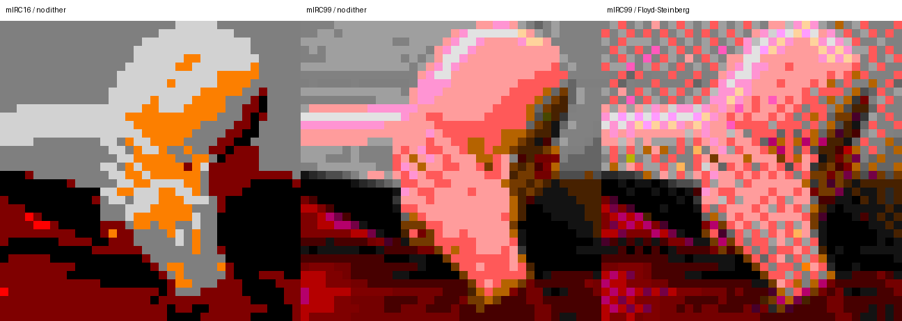
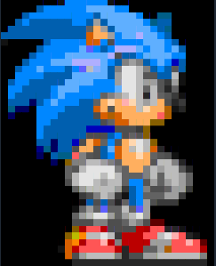

# IRCART for IRC Bots

Compact coloured IRC art from ordinary images.

This project provides an offline Python converter that turns PNG/JPEG images into small coloured IRC art using Unicode half-block characters (`▀`). Each output character represents two vertical source pixels by using the IRC foreground colour for the upper half and the IRC background colour for the lower half.

It was built for an IRC bot, but the format and converter are intentionally general-purpose.

## Features

- Converts PNG and JPEG images offline
- Preserves image aspect ratio
- Targets compact IRC-friendly dimensions
- Uses Unicode `▀` half-blocks for two vertical pixels per character
- Supports:
  - `mirc16` for broad compatibility
  - `mirc99` for much better colour reproduction on clients that support extended IRC colours correctly
- Optional grayscale output
- Optional saturation boost before quantization
- Optional Floyd–Steinberg dithering
- Plain or RLE-compressed `.ircart` files
- Strict parser and validator
- Optimized IRC rendering with redundant colour changes removed
- Bot-side helper with no Pillow dependency
- Reports UTF-8 byte lengths so flood control can remain separate from rendering

## Requirements

The image converter requires Python 3 and Pillow:

```bash
pip install pillow
```

The bot-side helper does not require Pillow.

## Files

Typical files in this setup are:

```text
ircart.py
ircart_helper.py
```

`ircart.py` handles image conversion, `.ircart` parsing, validation, preview generation, and IRC rendering.

`ircart_helper.py` is intended for use inside the bot. It loads a `.ircart` file and returns ready-to-send IRC message bodies without performing any sending, sleeping, throttling, or queue management.

## Quick start

Image Quality Comparison:





Convert an image using the recommended high-quality settings:

```bash
python3 ircart.py convert picard.jpg picard.ircart \
  --palette mirc99 \
  --mode color \
  --dither none \
  --encoding rle
```

PNG works too:

```bash
python3 ircart.py convert picard.png picard.ircart \
  --palette mirc99 \
  --mode color \
  --dither none \
  --encoding rle
```

The default output is approximately 36 IRC characters wide and 18 IRC lines high.

You can override the limits:

```bash
python3 ircart.py convert picard.jpg picard.ircart \
  --palette mirc99 \
  --mode color \
  --dither none \
  --encoding rle \
  --max-width 40 \
  --max-height 20
```

## Previewing output

The converter can also write a PNG preview of the quantized artwork:

```bash
python3 ircart.py convert picard.jpg picard.ircart \
  --palette mirc99 \
  --mode color \
  --dither none \
  --encoding rle \
  --preview picard-preview.png
```

The preview shows the sampled colour grid. Actual IRC appearance still depends on the receiving client's font and colour palette.

## Saturation

You can increase or decrease image saturation before palette quantization:

```bash
--saturation 1.0
```

`1.0` leaves the source saturation unchanged.

Values above `1.0` increase saturation:

```bash
--saturation 1.4
```

```bash
--saturation 1.8
```

Values below `1.0` reduce saturation:

```bash
--saturation 0.8
```

For pale or low-saturation portraits, increasing saturation can help the quantizer choose warmer IRC colours instead of collapsing too much of the image into greys.

Example:

```bash
python3 ircart.py convert processing/girl.png girl.ircart \
  --palette mirc99 \
  --mode color \
  --saturation 1.8 \
  --dither none \
  --encoding rle \
  --preview girl-preview.png
```

The default remains `1.0`, so existing conversions are unchanged unless you explicitly request a boost.

Saturation is intended for `--mode color`. It is ignored for practical purposes in grayscale mode.

## Grayscale mode

Grayscale can be useful for photographs that do not map attractively to the limited IRC colour palette.

Use:

```bash
--mode grayscale
```

Example:

```bash
python3 ircart.py convert processing/girl.png girl-grey.ircart \
  --palette mirc99 \
  --mode grayscale \
  --dither none \
  --encoding rle \
  --preview girl-grey-preview.png
```

With `mirc99`, grayscale uses the fixed grayscale ramp at colour indexes `88` through `98`.

With `mirc16`, grayscale falls back to the available black, grey, light-grey, and white slots. Exact shades can vary between clients and themes.

Normal colour conversion remains:

```bash
--mode color
```

## Palette choice

### `mirc99`

Recommended when the receiving IRC client supports the extended colour palette correctly.

```bash
--palette mirc99
```

This gives substantially better photographic results because colour indexes `16` through `98` provide a much larger palette.

### `mirc16`

Use for broader compatibility with older or more limited clients:

```bash
--palette mirc16
```

Example:

```bash
python3 ircart.py convert picard.jpg picard16.ircart \
  --palette mirc16 \
  --mode color \
  --dither none \
  --encoding rle
```

The classic 16 IRC colours are more widely supported, but their exact RGB appearance can vary between clients and themes. Because of that, `mirc16` is best treated as a compatibility mode rather than a colour-accurate mode.

A practical setup is to keep both versions:

```text
picard99.ircart
picard16.ircart
```

and trigger whichever one is appropriate.

## Dithering

Dithering is optional.

No dithering:

```bash
--dither none
```

Floyd–Steinberg dithering:

```bash
--dither floyd-steinberg
```

For small IRC art, `mirc99` with no dithering is often cleaner. Dithering can introduce visible speckling at very small sizes, although it may help with gradients or some photographs.

## IRCART/1 format

The generated file is safe UTF-8 text. It contains no raw IRC control characters.

Example header:

```text
IRCART/1
palette=mirc99
width=36
height=18
glyph=upper-half
encoding=rle
```

Each logical cell stores a foreground and background colour index:

```text
FG,BG
```

For example:

```text
95,76
```

means:

- foreground colour `95` for the upper half
- background colour `76` for the lower half
- rendered using the Unicode upper half block: `▀`

A plain row might look like:

```text
95,95 95,95 94,95 95,76 76,87
```

## RLE encoding

RLE is used only for storage in the `.ircart` file.

For example:

```text
3*94,95 5*95,95 76,87
```

means:

```text
94,95 94,95 94,95 95,95 95,95 95,95 95,95 95,95 76,87
```

This can substantially reduce file size for images with large flat regions.

The parser validates RLE strictly and rejects runs that would expand past the declared row width.

## Inspecting a file

Validate and summarize an `.ircart` file:

```bash
python3 ircart.py inspect picard.ircart
```

Example output:

```text
Valid IRCART/1: palette=mirc99, 36 chars x 18 lines
```

## Rendering to IRC text

Render an `.ircart` file into IRC-formatted message bodies:

```bash
python3 ircart.py render picard.ircart rendered.txt
```

For debugging, use escaped control codes:

```bash
python3 ircart.py render picard.ircart rendered-debug.txt --escape
```

The debug form shows IRC controls visibly, for example:

```text
\x0395,76▀▀▀\x0376,87▀▀\x0f
```

where:

- `\x03` is the IRC colour control
- `95,76` is foreground/background
- `▀` is the half-block glyph
- `\x0f` resets formatting

The real rendered output contains the actual control characters, not the visible escape sequences.

## Bot integration

The bot-side helper can be imported directly:

```python
from ircart_helper import load_for_irc
```

Load an image asset:

```python
art = load_for_irc("picard.ircart")
```

The returned object contains:

```python
art.width
art.height
art.palette
art.lines
art.utf8_bytes
art.max_utf8_bytes
art.total_utf8_bytes
```

`art.lines` is a tuple of IRC message bodies ready to pass into the bot's existing queue or flood-control system.

Example:

```python
from ircart_helper import load_for_irc

art = load_for_irc("picard.ircart")

for line in art.lines:
    queue_for_irc(channel, line)
```

The helper deliberately does not:

- send to IRC
- sleep between lines
- rate-limit
- queue messages
- split messages

Those responsibilities should remain with the bot's existing outbound message system.

## Message size safety

The helper reports UTF-8 byte lengths for each rendered line.

Example:

```python
for line, size in zip(art.lines, art.utf8_bytes):
    print(size, line)
```

You can optionally enforce a body-size budget:

```python
art = load_for_irc(
    "picard.ircart",
    max_body_bytes=350,
)
```

If any rendered message body exceeds the configured limit, the helper raises `IRCArtError`.

This is intentionally a message-body limit only. Your IRC layer may need to account separately for:

- `PRIVMSG`
- target/channel name
- spaces
- CRLF
- server-added prefix
- IRCv3 tags

## Security model

The converter is intended as an offline utility and should not be exposed directly to IRC users.

The bot-side parser still treats `.ircart` files as untrusted and enforces:

- known file format
- known palette names
- supported glyph mode
- supported encoding
- maximum width
- maximum height
- maximum input text size
- exact row counts
- exact cell counts
- valid colour indexes
- valid RLE expansion

This keeps the rendering path predictable even if an asset file is malformed.

## Recommended workflow

A practical workflow is:

```text
PNG/JPEG
  ↓
ircart.py convert
  ↓
.ircart asset
  ↓
ircart_helper.py
  ↓
validated IRC message bodies
  ↓
existing bot queue / flood control
  ↓
IRC
```

For best colour quality:

```bash
python3 ircart.py convert image.jpg image99.ircart \
  --palette mirc99 \
  --mode color \
  --dither none \
  --encoding rle
```

For a more vivid photo:

```bash
python3 ircart.py convert image.jpg image99-vivid.ircart \
  --palette mirc99 \
  --mode color \
  --saturation 1.6 \
  --dither none \
  --encoding rle
```

For grayscale:

```bash
python3 ircart.py convert image.jpg image-grey.ircart \
  --palette mirc99 \
  --mode grayscale \
  --dither none \
  --encoding rle
```

For compatibility:

```bash
python3 ircart.py convert image.jpg image16.ircart \
  --palette mirc16 \
  --mode color \
  --dither none \
  --encoding rle
```

## Notes on client compatibility

Extended `mirc99` colours look much better for photographic art, but support is not identical across all IRC clients.

Some clients render extended colour indexes correctly; others do not.

The classic `mirc16` palette is more portable, but even those 16 colours can differ in exact appearance between IRC clients and themes.

Because of this, the sender cannot guarantee identical RGB output everywhere.

## Unicode

The rendered art uses the Unicode character:

```text
▀
```

Make sure the bot source, terminal, and IRC client are using UTF-8.

## Example output dimensions

A 36 × 18 IRC image represents a sampled colour grid of:

```text
36 × 36 pixels
```

because each IRC line represents two vertical source pixels.

That is what allows compact images to retain much more vertical detail than one full block character per source pixel.

## License

Add your preferred license here.
